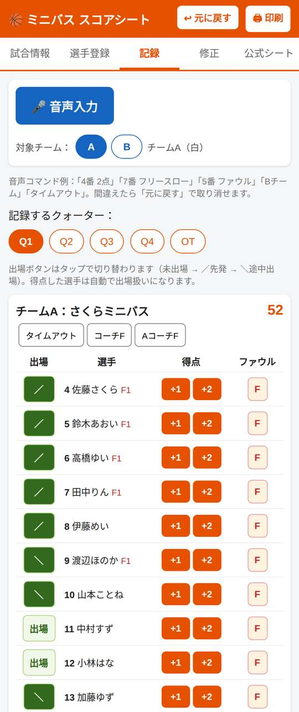
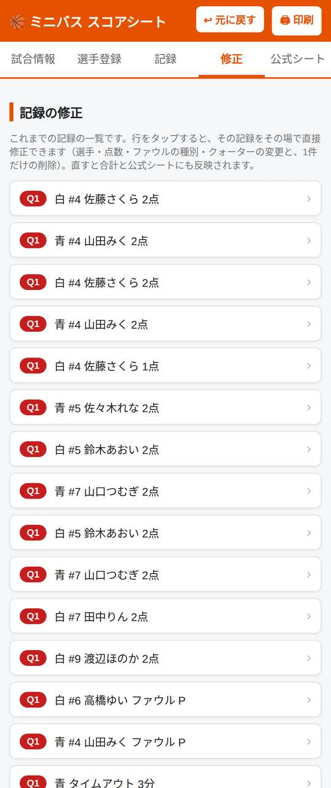

# ミニバス スコアシート（Androidアプリ）

ミニバスケットボール（U12）の試合記録アプリです。選手をタップ（または音声）で得点・ファウルを記録すると、**JBAミニバスケットボール公式スコアシート**の様式に自動で転記され、A4判1枚で印刷できます。

公式シートは、JBA公式PDFを画像化したものを土台にして、その上に記録を描き込む方式です。土台そのものが公式様式なので、枠や罫線が本物とずれることはありません。


※画像はサンプル試合のものです（選手名などは架空のものです）。

## 機能

- **試合情報の入力**：大会名・日付・時間・会場・試合No.（Game No.）、審判・TO（クルーチーフ、アンパイア、スコアラー、タイマー、A・スコアラー、ショットクロックオペレイター）、試合終了時間、3ポイントルール採用の有無
- **選手登録**：両チーム各15人まで（背番号・氏名・ライセンスNo.下3桁）、コーチ・Aコーチ、ユニフォーム色（チームAは白で固定、チームBは色を入力）
- **試合の記録**（Q1〜Q4＋延長）
  - 選手をタップして得点を記録：フリースロー1点／フィールドゴール2点／3ポイント（採用する大会のみ、設定でON）
  - ファウルの記録：P・P1・P2・P3・U・U1・U2・T・T1・D（コーチは C・B・M 系）
  - 出場時限の記録：先発は「／」、途中出場は「＼」（タップで切り替え。得点した選手は自動で出場扱い）
  - タイムアウトの記録（クォーターごとに経過分を記録）
  - **音声入力**：「4番 2点」「7番 フリースロー」「5番 ファウル」「タイムアウト」など、声でも記録できます（氏名欄などへの音声入力にも対応）
  - 「元に戻す」で直前の記録を取り消し可能
- **記録の修正**：記録の一覧から1件だけを選んで、その場で直接修正・削除できます（ハーフタイム中の訂正などに）
- **公式シート表示**：公式様式そのままのシートに記録が描き込まれて表示されます
- **締めの線**：試合を「試合終了」にすると、紙のシートと同じ締めの線が自動で入ります（下の「公式様式への対応」参照）
- **A4印刷／画像保存**：Androidの印刷機能で公式シートだけをA4縦1枚で印刷できます。PNG画像として保存もできます
- **自動保存**：入力データは端末内（localStorage）に自動保存され、アプリを閉じても続きから入力できます

## 操作手順

### 1. 試合情報を入力する

「試合情報」タブで、大会名・日付・開始時間・会場・試合No.を入力します。審判・TOの氏名、試合終了時間もここで入力します。3ポイントルールを採用する大会では「3ポイントシュート採用」をONにしてください。

### 2. 選手を登録する

「選手登録」タブで、両チームの選手（各15人まで）の背番号・氏名・ライセンスNo.下3桁と、コーチ・Aコーチを入力します。チーム名とユニフォーム色もここで設定します。氏名欄のマイクボタンで音声入力もできます。

### 3. 試合を記録する

「記録」タブで記録します。



1. 上部のボタンで、記録するクォーター（Q1〜Q4・OT）を選びます
2. 得点は選手の行の「+1」「+2」（3ポイント採用時は「+3」）をタップ
3. ファウルは「F」ボタンをタップし、種類（P・U・T など）を選びます
4. 出場は左端のボタンをタップして切り替えます（未出場 → ／先発 → ＼途中出場）
5. タイムアウトはチーム名の下の「タイムアウト」ボタンから、クォーターと経過分を記録します
6. コーチのファウルは「コーチF」「AコーチF」ボタンから記録します

**音声入力**：「🎤 音声入力」ボタンを押し、対象チーム（A／B）を選んでから話します。

- 「4番 2点」… 4番に2点
- 「7番 フリースロー」… 7番にフリースロー（1点）
- 「5番 ファウル」… 5番にファウル（P）
- 「Bチーム」… 対象チームの切り替え
- 「タイムアウト」… タイムアウトの記録画面を開く

間違えたら、右上の「↩ 元に戻す」で直前の記録を取り消せます。

### 4. 記録を修正する

「修正」タブに、これまでの記録が入れた順番に一覧表示されます。



行をタップすると、その1件だけを直接修正できます（選手・点数・ファウルの種類・クォーターの変更と、1件だけの削除）。直すと合計点や公式シートにもすぐ反映されます。「元に戻す」で全部戻す必要はありません。

### 5. 公式シートを確認して印刷する

「公式シート」タブで、公式様式に転記されたシートを確認します。

- 試合が終わったら「試合情報」タブで**「試合終了（締めの線）」をON**にすると、締めの線が入ります
- 右上の「🖨 印刷」ボタンで、A4縦1枚に印刷できます
- 「画像として保存」ボタンで、シートをPNG画像として保存もできます

## 公式様式への対応（印刷仕様）

公式シートは、JBA公式スコアシートのPDFを画像化したものを土台に、実測したセル座標へ記録を描き込む方式です。

- タイトル「MINI-BASKETBALL OFFICIAL SCORESHEET」
- ヘッダー枠：大会名／日付／時間／会場／Game No.、各Qスコアと最終合計のスコア欄、審判・TO欄
- チーム表：通し番号1〜15、ライセンスNo.（3桁セル）、選手氏名、背番号No.、出場時限①②③④、ファウル1〜5、コーチ・Aコーチ行、タイムアウト欄（1Q・2Q・3Q・4Q・OT）
- チームファウル枠（1Q・2Q／3Q・4Q、ファウル数に応じて数字を×で消去）
- ランニングスコア：1〜120点を3グループ（1–40／41–80／81–120）で表示し、公式の記号で記録
  - フィールドゴール＝点数の枠に対角線＋横に選手の番号
  - フリースロー＝点数の枠に塗り丸（●）＋横に選手の番号
  - 3ポイント＝選手の番号を○で囲む
  - 各Q終了＝最後の得点を○で囲み下に太線、試合終了＝太い○＋太い2本線
  - 記録色は公式の約束どおり、第1Q・第3Qは赤、第2Q・第4Q・延長は濃色（青）
- 勝利チーム・試合終了時間欄
- 印刷時はアプリのUIを除き、シートのみがA4縦1枚に収まります

### 締めの線（試合終了時）

紙のシートで記入後に引く「締め」と同じ線を、試合終了にしたときに自動で描きます。

- 登録した最後の選手の下に太線
- 各選手のファウル欄の、使わなかったセルに横線（コーチ・Aコーチ行も同様）
- 登録のなかった行のファウル欄に斜線
- 出場しなかった選手が下の方に2人以上続く場合、その範囲のファウル欄に斜線、先頭の選手の出場時限欄に横線
- 使わなかったタイムアウト枠に2本の横線（クォーターの色）
- チームファウルの使わなかった数字セルに縦の2本線（クォーターの色）
- ランニングスコアはチームごとに、最終得点の下から自分の欄だけに斜線

## アプリの構成

- **言語**：Kotlin（Android側）＋ HTML/CSS/JavaScript（スコアシート本体）
- **方式**：単一ActivityがWebViewでローカルアセット（`app/src/main/assets/scoresheet/`）を表示するハイブリッド構成
  - 入力UI・公式シート描画はWeb技術で実装（公式シートはCanvasに公式様式の画像＋記録を描画）
  - 印刷は `PrintManager` へJavaScriptブリッジ（`AndroidPrint.printSheet()`）で連携
  - 音声入力は Android の `SpeechRecognizer` へJavaScriptブリッジ（`AndroidVoice`）で連携
  - データ保存はWebViewのlocalStorage
- **パッケージ名**：`jp.k3286.minibasscoresheet`
- **動作環境**：Android 8.0（API 26）以上

## ビルド方法（Android Studio）

1. このリポジトリをクローン（またはダウンロード）します。
2. Android Studioでプロジェクトフォルダを開きます。
3. 初回は Gradle Wrapper が自動生成/ダウンロードされます（コマンドラインで生成する場合は `gradle wrapper` を実行）。
4. 「Run」ボタンで実機・シミュレータにインストール、または Build > Build App Bundle(s) / APK(s) からAPKを作成します。

コマンドラインの場合（Gradle 8.9 / JDK 17）：

```bash
gradle assembleDebug
# 出力: app/build/outputs/apk/debug/app-debug.apk
```

## GitHub Actions によるAPKビルド（任意）

`.github/workflows/build.yml` を追加すると、`main` ブランチへ push するたびに GitHub Actions が自動でデバッグAPKをビルドします。

※現在のリポジトリには、権限の都合でこのファイルがまだ含まれていません。使う場合は、GitHubの画面から `.github/workflows/build.yml` を手動で追加してください（ファイルの内容は開発者にお問い合わせください）。

1. リポジトリの **Actions** タブを開く
2. 完了したワークフロー実行（Build Debug APK）を開く
3. Artifacts の **minibas-scoresheet-debug-apk** をダウンロードする
4. 中の `app-debug.apk` をAndroid端末にインストールする（提供元不明アプリの許可が必要です）

Actions画面から手動で実行（Run workflow）することもできます。

## ライセンス

スコアシートの様式はJBA（日本バスケットボール協会）の公式スコアシートに基づきます。このアプリは個人の試合記録用に作成したものです。
