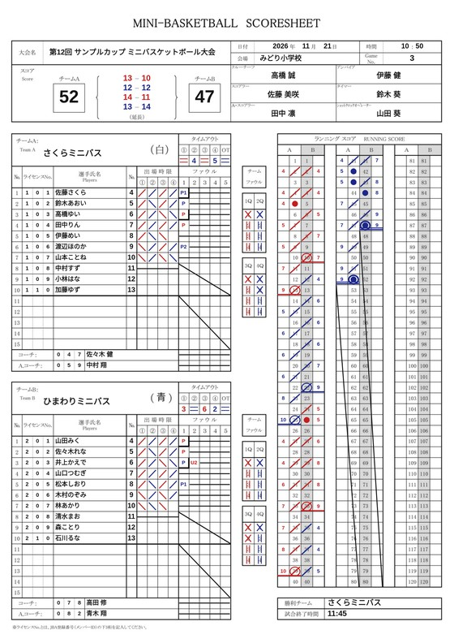
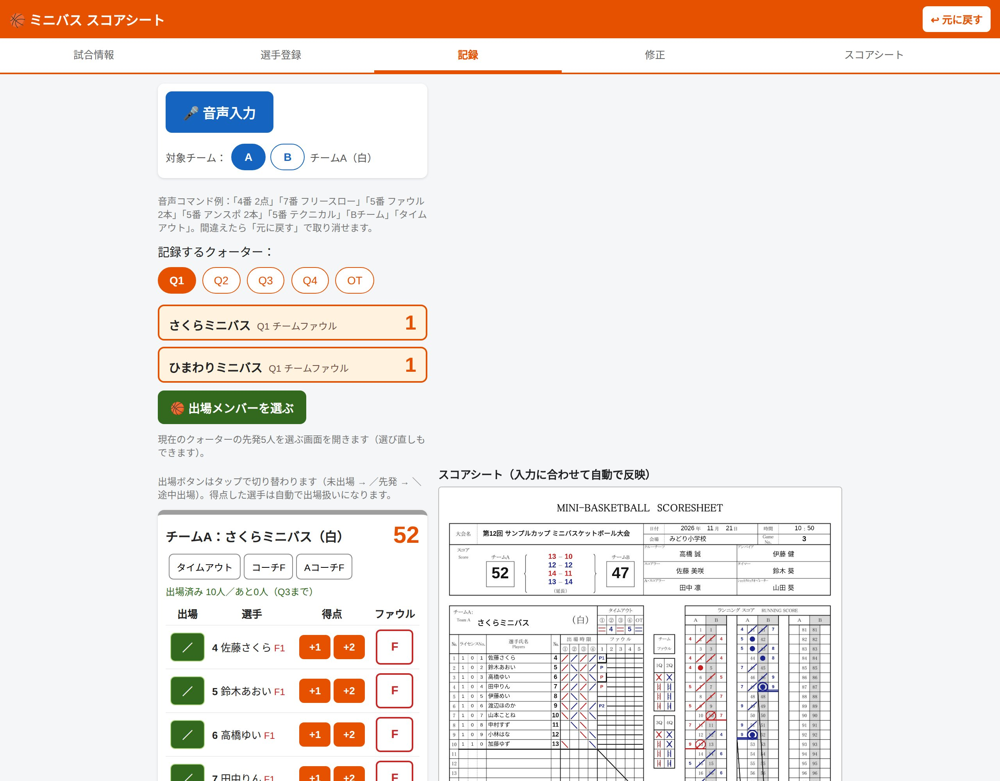
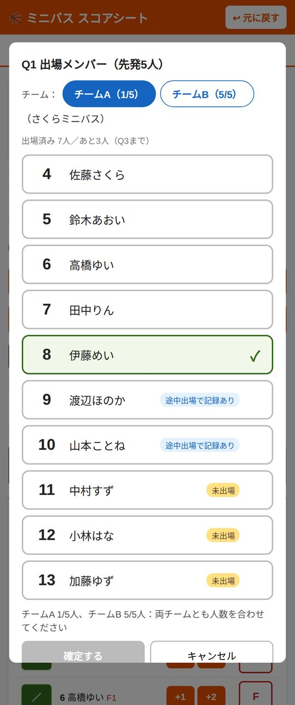

# ミニバス スコアシート（Androidアプリ）

ミニバスケットボール（U12）の試合記録アプリです。選手をタップ（または音声）で得点・ファウルを記録すると、**JBAミニバスケットボール公式スコアシート**の様式に自動で転記され、A4判1枚のPDFや画像で保存できます。

公式シートは、JBA公式PDFを画像化したものを土台にして、その上に記録を描き込む方式です。土台そのものが公式様式なので、枠や罫線が本物とずれることはありません。



※画像はサンプル試合のものです（選手名などは架空のものです）。

## 機能

- **試合情報の入力**：大会名・日付・時間・会場・試合No.（Game No.）、審判・TO（クルーチーフ、アンパイア、スコアラー、タイマー、A・スコアラー、ショットクロックオペレイター）、試合終了時間、3ポイントルール採用の有無
- **選手登録**：両チーム各15人まで（背番号・氏名・ライセンスNo.下3桁）、コーチ・Aコーチ、ユニフォーム色（チームAは白で固定、チームBは色を入力）
- **メンバー表のOCR取り込み**：大会で渡されるメンバー表（紙）を撮影（または写真から選択）すると、端末内の文字認識で背番号・氏名・ライセンスNo.下3桁を読み取り、確認画面で直してから選手登録に反映できます。写真や名前が外部に送信されることはありません
- **名簿の保存・呼び出し**：入力した名簿は「💾 この名簿を保存」でアプリ内に保存でき、次の試合では「📂 名簿を呼び出す」から選んで読み込めます。過去の試合の名簿からも呼び出せるので、いつものチームの入力を毎回し直す必要がありません
- **試合の記録**（Q1〜Q4＋延長）
  - 選手をタップして得点を記録：フリースロー1点／フィールドゴール2点／3ポイント（採用する大会のみ、設定でON）
  - ファウルの記録：P・P1・P2・P3・U・U1・U2・T・T1・D（コーチは C・B・M 系）
  - 出場時限の記録：先発は「／」、途中出場は「＼」（タップで切り替え。得点した選手は自動で出場扱い）
  - **Q開始時の出場メンバー選択**：クォーターを切り替えると（そのQの出場が未設定の場合）先発5人をタップで選ぶ画面が自動で開き、選んだ選手に「／」が自動で記録されます。「前のQと同じ」で直前のクォーターの顔ぶれを引き継げます。記録タブの「🏀 出場メンバーを選ぶ」からいつでも開き直して直せます
  - **未出場の見える化**：まだ出場していない選手には「未出場」の表示が付き、チームごとに「出場済み ○人／あと○人（Q3まで）」と進捗が出ます（ミニバスでは登録10人以上の場合、Q3終了時点で10人以上の出場が必要です）
  - タイムアウトの記録（各クォーター1回まで。取った時点の経過分を記録し、公式シートにそのクォーターの色で書き入れます）
  - **チームファウル表示**：記録タブの上に、今のクォーターのチームファウル数が両チーム分大きく表示されます（選手のファウルだけを数え、コーチ・ベンチのテクニカルとマンツーマンペナルティは数えません）
  - **音声入力**：「4番 2点」「7番 フリースロー」「5番 ファウル」「タイムアウト」など、声でも記録できます（氏名欄などへの音声入力にも対応）
  - 「元に戻す」で直前の記録を取り消し可能
- **記録の修正**：記録の一覧から1件だけを選んで、その場で直接修正・削除できます（ハーフタイム中の訂正などに）
- **公式シート表示**：公式様式そのままのシートに記録が描き込まれて表示されます
- **締めの線**：試合を「試合終了」にすると、紙のシートと同じ締めの線が自動で入ります（下の「公式様式への対応」参照）
- **画像保存／PDF保存**：公式シートをPNG画像として保存でき、資料として残しやすいPDF（A4 1ページ）でも保存できます
- **シートの共有**：「📤 PDFを共有」「📤 画像を共有」からは、保存を経ずにLINEなどのアプリへ直接送れます。試合後にコーチや大会本部へ渡すときに便利です。保存・共有ボタンはシートの下に「画像（保存・共有）」「PDF（保存・共有）」の順に並んでいるので、シートを確認し終わった流れでそのまま送れます
- **自動保存**：入力データは端末内（localStorage）に自動保存され、アプリを閉じても続きから入力できます
- **チームの色分け表示**：記録タブのパネルはチームA（白系）とチームB（青系）で色分けされ、現在のスコアも大きく表示されます。チームの取り違え防止に
- **ファウル「あと1回」表示**：ファウルが4つになった選手の行が目立つ色になり、「あと1回」の表示が付きます（5つで退場）
- **ルール違反の警告**：退場（5ファウル）した選手に得点・ファウル・出場を記録しようとしたとき／Q3へ進む時点でQ3終了までの出場条件（10人、または登録全員）をまだ満たしていないとき／Q3が終わるまでに10人出場していないのにQ4へ進もうとしたとき／同点のまま試合終了にしようとしたとき、確認の警告が出ます。いずれも警告のみで、確認すればそのまま記録できます（訂正作業の邪魔はしません）
- **クォーター終了時のスコア確認**：得点が入っているクォーターから先のクォーターへ進むとき、現在のスコアを確認してから切り替えます
- **音声入力の結果表示**：音声で記録が入ると、結果が画面に大きく一瞬表示されるので、聞き取り違いにその場で気づけます
- **れんしゅうモード**：架空の試合（さくらミニバス対ひまわりミニバス）で得点・ファウルの入力を練習できます。見本の選手は各チーム14人か15人（ランダム）登録されます。本番のデータとは保存先が別なので、影響しません。子どもや初めてテーブルオフィシャルをする人の練習に
- **記録タブのチーム切替表示**：スマホ幅では、両チームの選手を縦に並べると画面が長くなるため、記録タブはチーム切替式です。両チームの名前とスコアが出たボタンで切り替え、選択中のチームだけを表示します（音声入力の対象チームとも連動）。ファウルの「F」ボタンは試合中でも押しやすい大きさです。タブレット幅では切替なしで両チームがそのまま並びます（下の「タブレットでの同時表示」参照）
- **公式シートの拡大表示**：公式シートタブに拡大・縮小ボタンがあり、スマホでもシートの記入内容を拡大して確認できます。「全体を表示」を押すと、シート全体が枠の中に一度に収まる大きさになります（保存されるPDF・画像には影響しません）
- **タブレットでの同時表示**：画面の横幅が広い端末（タブレットなど）では、記録タブの右側に公式シートが並んで表示され（記録：シート＝4：6）、得点やファウルを入れるたびにその場でシートへ反映されます。シートは常に全体が見える大きさで追随し、記録側はチーム切替なしで両チームのパネルがそのまま並ぶので、切り替えずに両チームへ記録できます。スマホ幅では今まで通り記録だけが表示されます
- **過去の試合**：「新しい試合」を始めると、入力済みの試合は自動で「過去の試合」に保存され（最大20試合）、あとから開いて見直せます。PDF保存を忘れても記録が消えません
- **データのバックアップ**：「試合情報」タブの「💾 バックアップを書き出す」で、進行中の試合・過去の試合・れんしゅうモードのデータを1つのファイル（JSON）に書き出せます。機種変更や故障のときは「📂 バックアップから戻す」でそのファイルを選ぶと元通りに戻ります（今のデータは上書きされるので、確認画面が出ます）
- **自動バックアップ**：「試合終了」にチェックすると、その時点のデータがアプリ内にも自動で保存されます（最大3件）。うっかり操作で消してしまっても「↩ 自動バックアップから戻す」で戻せます。端末自体の故障には備えられないので、ファイルへの書き出しとあわせてどうぞ
- **背景のカスタマイズ**：試合情報タブの設定で、画面いちばん後ろの背景だけを変えられます。色のプリセット（デフォルト／白／薄グレー／薄ブルー／薄グリーン／薄オレンジ／薄ピンク）か、端末の写真から1枚選択。写真には白かぶせ（60〜97%、スライダーで調整）を重ねるので文字は読みにくくなりません。公式シートの様式やカードの見た目は変わりません。設定は端末内に保存され、バックアップファイルには含まれません
- **起動時のバインダー表紙**：アプリを開くと、左に背表紙とリングのあるバインダーの表紙（タイトル／バージョン／クレジット「作：バスケおっさん」）が表示され、約1秒で左へ開くアニメーションでいつもの画面になります。タップすればすぐ開きます。表紙の絵柄は、ダンクシルエット／右下の大きなボール／横向きのハーフコート図（キーのハッシュマークやバックボードまで描いたもの）／黒背景に右下のボール（全体が見える版）の4種が順番に一巡するローテーションで、金のレア表紙（バスケットボールに前足を乗せた虎と、岩の上の虎・竹・岩を描いた屏風絵風）だけが毎回10%の抽選で割り込みます
- **スリープ防止**：「試合情報」タブの「試合中は画面を消さない」をオン（初期値オン）にすると、アプリを開いている間は画面がスリープしません

## 操作手順

### 1. 試合情報を入力する

「試合情報」タブで、大会名・日付・開始時間・会場・試合No.を入力します。審判・TOの氏名、試合終了時間もここで入力します。3ポイントルールを採用する大会では「3ポイントシュート採用」をONにしてください。

### 2. 選手を登録する

「選手登録」タブで、両チームの選手（各15人まで）の背番号・氏名・ライセンスNo.下3桁と、コーチ・Aコーチを入力します。チーム名とユニフォーム色もここで設定します。氏名欄のマイクボタンで音声入力もできます。

相手チームなどから紙のメンバー表を渡された場合は、各チームの「📷 メンバー表を取り込む」ボタンから撮影（または写真を選択）すると、背番号・氏名・ライセンスNo.下3桁が読み取られます。読み取り結果は確認画面で一覧表示されるので、間違いを直してから「この内容で登録する」を押してください（既に登録がある場合は、置き換えるか確認します）。登録が終わると完了画面から「続けてQ1の出場メンバーを選ぶ」で、そのままQ1の先発選択に進めます。

### 3. 試合を記録する

「記録」タブで記録します。


タブレットなどの広い画面では、記録の右側に公式シートが並び、入力するたびに反映されます（記録：シート＝4：6）。



クォーターの開始時は、先発5人をタップで選ぶ画面が開きます（まだ出場していない選手には「未出場」と表示されます）。



1. 上部のボタンで、記録するクォーター（Q1〜Q4・OT）を選びます。そのQの出場がまだ決まっていない場合は、先発5人を選ぶ画面が自動で開きます。両チームの選手をタップして5人ずつ選び、「確定する」を押すと出場時限に「／」が記録されます（前のクォーターと同じ顔ぶれなら「前のQ（○）と同じメンバーにする」が便利です）。選び直したいときは「🏀 出場メンバーを選ぶ」ボタンから開き直せます
2. 得点は選手の行の「+1」「+2」（3ポイント採用時は「+3」）をタップ
3. ファウルは「F」ボタンをタップし、種類（P・U・T など）を選びます。種類を選ぶ画面の下には、各記号の意味（P＝パーソナル、U＝アンスポーツマンライク など）と、後ろの数字が相手に与えるフリースローの本数であることの説明が出ます
4. Qの途中で交代した場合は、左端の出場ボタンをタップして切り替えます（未出場 → ／先発 → ＼途中出場）。まだ出場していない選手には「未出場」と表示され、チーム名の下には「出場済み ○人／あと○人（Q3まで）」の進捗が出ます
5. タイムアウトはチーム名の下の「タイムアウト」ボタンを押し、経過分（クォーターの長さから残り時間の「分」を引いた数字。6分クォーターで残り2分35秒なら4分）を選んで記録します。各クォーター1回までで、取るとボタンが「タイムアウト済み」になり、そのクォーターではもう取れません
6. コーチのファウルは「コーチF」「AコーチF」ボタンから記録します

**音声入力**：「🎤 音声入力」ボタンを押し、対象チーム（A／B）を選んでから話します。

- 「4番 2点」… 4番に2点
- 「7番 フリースロー」… 7番にフリースロー（1点）
- 「5番 ファウル」… 5番にファウル（P）
- 「Bチーム」… 対象チームの切り替え
- 「タイムアウト」… 対象チームの経過分ピッカーが開きます。「タイムアウト 4分」のように分まで言うと、そのまま記録します（そのクォーターで取得済みのときは記録されません）

間違えたら、右上の「↩ 元に戻す」で直前の記録を取り消せます。

### 4. 記録を修正する

「修正」タブに、これまでの記録が入れた順番に一覧表示されます。


行をタップすると、その1件だけを直接修正できます（選手・点数・ファウルの種類・クォーターの変更と、1件だけの削除）。直すと合計点や公式シートにもすぐ反映されます。「元に戻す」で全部戻す必要はありません。

### 5. 公式シートを確認して保存する

「公式シート」タブで、公式様式に転記されたシートを確認します。

- 試合が終わったら「試合情報」タブで**「試合終了（締めの線）」をON**にすると、締めの線が入ります
- 「画像として保存」ボタンで、シートをPNG画像として保存できます
- 「PDFで保存」ボタンで、シートをPDF（A4 1ページ）で保存できます。ファイル名は「スコアシート_試合日.pdf」になります

## 公式様式への対応（様式仕様）

公式シートは、JBA公式スコアシートのPDFを画像化したものを土台に、実測したセル座標へ記録を描き込む方式です。

- タイトル「MINI-BASKETBALL OFFICIAL SCORESHEET」
- ヘッダー枠：大会名／日付／時間／会場／Game No.、各Qスコアと最終合計のスコア欄、審判・TO欄
- チーム表：通し番号1〜15、ライセンスNo.（3桁セル）、選手氏名、背番号No.、出場時限①②③④、ファウル1〜5、コーチ・Aコーチ行、タイムアウト欄（1Q・2Q・3Q・4Q・OT）
- チームファウル枠（1Q・2Q／3Q・4Q、ファウル数に応じて数字を×で消去）
- ランニングスコア：1〜120点を3グループ（1–40／41–80／81–120）で表示し、公式の記号で記録
  - フィールドゴール＝点数の枠に対角線＋横に選手の番号
  - フリースロー＝点数の枠に塗り丸（●）＋横に選手の番号
  - 3ポイント＝選手の番号を○で囲む
  - 各Q終了＝最後の得点を○で囲み下に太線、試合終了＝太い○＋太い2本線
  - 記録色は公式の約束どおり、第1Q・第3Qは赤、第2Q・第4Q・延長は濃色（青）
- 勝利チーム・試合終了時間欄
- 保存されるPDF・画像は、シートのみがA4縦1枚に収まる形です

### 締めの線（試合終了時）

紙のシートで記入後に引く「締め」と同じ線を、試合終了にしたときに自動で描きます。

- 登録した最後の選手の下に太線
- 各選手のファウル欄の、使わなかったセルに横線（コーチ・Aコーチ行も同様）
- 登録のなかった行のファウル欄に斜線（左上から右下）
- 出場しなかった選手が下の方に2人以上続く場合、その範囲のファウル欄に斜線（左上から右下）、先頭の選手の出場時限欄に横線
- 使わなかったタイムアウト枠に2本の横線（クォーターの色）
- チームファウルの使わなかった数字セルに縦の2本線（クォーターの色）
- ランニングスコアはチームごとに、最終得点の下から自分の欄だけに斜線

### ファウルの太線（第2Q終了時）

公式記入例どおり、第2Qの終わりに、使用した枠と未使用の枠の間に濃色の太線を引きます（第3Q以降に表示されます）。

- 各選手・コーチ・Aコーチの行で、前半（第1Q・第2Q）最後のファウルの右端に縦の太線、前半に使った枠の下に横の太線
- 前半にファウルのない選手には引きません
- 試合終了のときに引くのは上の「締めの線」だけで、太線は足しません

## アプリの構成

- **言語**：Kotlin（Android側）＋ HTML/CSS/JavaScript（スコアシート本体）
- **方式**：単一ActivityがWebViewでローカルアセット（`app/src/main/assets/scoresheet/`）を表示するハイブリッド構成
  - 入力UI・公式シート描画はWeb技術で実装（公式シートはCanvasに公式様式の画像＋記録を描画）
  - 音声入力は Android の `SpeechRecognizer` へJavaScriptブリッジ（`AndroidVoice`）で連携
  - 画像・PDFの保存は SAF（`ACTION_CREATE_DOCUMENT`）へJavaScriptブリッジ（`AndroidSave.saveFile()`）で連携
  - メンバー表のOCR取り込みは ML Kit（日本語・モデル同梱版）へJavaScriptブリッジ（`AndroidOcr`）で連携し、端末内で文字認識（撮影は `ACTION_IMAGE_CAPTURE`、写真選択は `ACTION_OPEN_DOCUMENT` へ委譲）
  - データ保存はWebViewのlocalStorage
- **パッケージ名**：`jp.k3286.minibasscoresheet`
- **動作環境**：Android 8.0（API 26）以上

## ビルド方法（Android Studio）

1. このリポジトリをクローン（またはダウンロード）します。
2. Android Studioでプロジェクトフォルダを開きます。
3. 初回は Gradle Wrapper が自動生成/ダウンロードされます（コマンドラインで生成する場合は `gradle wrapper` を実行）。
4. 「Run」ボタンで実機・シミュレータにインストール、または Build > Build App Bundle(s) / APK(s) からAPKを作成します。

コマンドラインの場合（Gradle 8.9 / JDK 17）：

```bash
gradle assembleDebug
# 出力: app/build/outputs/apk/debug/app-debug.apk
```

## GitHub Actions によるAPKビルド（任意）

`.github/workflows/build.yml` を追加すると、`main` ブランチへ push するたびに GitHub Actions が自動でデバッグAPKをビルドします。

※現在のリポジトリには、権限の都合でこのファイルがまだ含まれていません。使う場合は、GitHubの画面から `.github/workflows/build.yml` を手動で追加してください（ファイルの内容は開発者にお問い合わせください）。

1. リポジトリの **Actions** タブを開く
2. 完了したワークフロー実行（Build Debug APK）を開く
3. Artifacts の **minibas-scoresheet-debug-apk** をダウンロードする
4. 中の `app-debug.apk` をAndroid端末にインストールする（提供元不明アプリの許可が必要です）

Actions画面から手動で実行（Run workflow）することもできます。

## ライセンス

スコアシートの様式はJBA（日本バスケットボール協会）の公式スコアシートに基づきます。このアプリは個人の試合記録用に作成したものです。
